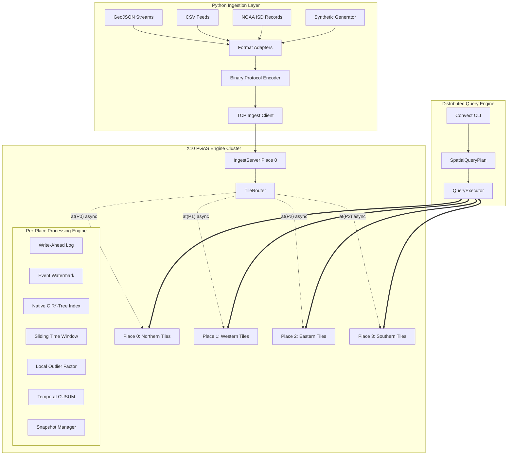
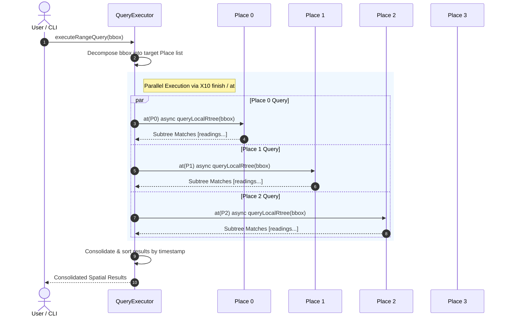

# Convect System Design Specification

## 1. System Architecture



## 2. Ingestion Wire Framing Specification

Every message sent across the ingestion socket is wrapped in a self-describing binary frame:

```
+--------+--------+--------+--------+----------+---------+
| Magic  | Ver    | Type   | Length | Payload  | CRC32   |
| 2B     | 1B     | 1B     | 4B     | variable | 4B      |
+--------+--------+--------+--------+----------+---------+
```

### Field Definitions:
- `Magic` (2 Bytes): `0xC0EC` (Big-Endian). Distinctive visual identifier for wire inspection.
- `Version` (1 Byte): `0x01`. Incremented on breaking payload schema revisions.
- `Type` (1 Byte):
  - `0x01`: `SENSOR_READING` (Single reading)
  - `0x02`: `BATCH_READINGS` (Repeated array of readings)
  - `0x03`: `HEARTBEAT` (Cluster health keepalive)
  - `0x04`: `CONTROL` (Administrative commands)
- `Length` (4 Bytes): Unsigned 32-bit integer specifying payload size in bytes.
- `Payload` (Variable): Type-specific binary layout.
- `CRC32` (4 Bytes): IEEE 802.3 32-bit CRC computed across `Magic`, `Ver`, `Type`, `Length`, and `Payload`. Frames failing checksum verification are immediately rejected without buffer corruption.

## 3. Distributed Query Execution Sequence



## 4. Fault Tolerance and State Recovery

Each X10 Place maintains two independent recovery mechanisms:
1. **Write-Ahead Log (WAL)**: All incoming sensor readings are written sequentially to an append-only log prior to indexing in the in-memory R*-tree or memory buffers.
2. **Periodic Snapshots**: The `SnapshotManager` periodically captures a checkpoint of the spatial index and sliding window accumulators, recording the latest sequence number $S_{snap}$.
3. **Recovery Sequence**: When a Place experiences hardware termination, the `FailoverCoordinator` reassigns its Hilbert partition to a healthy surviving peer. The recovering node initializes state from snapshot $S_{snap}$ and replays log entries from $S_{snap} + 1$ to the log tail, achieving exact state recovery.
